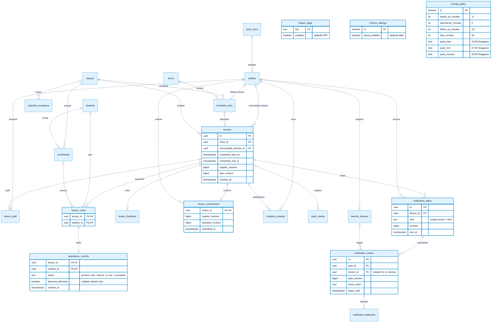
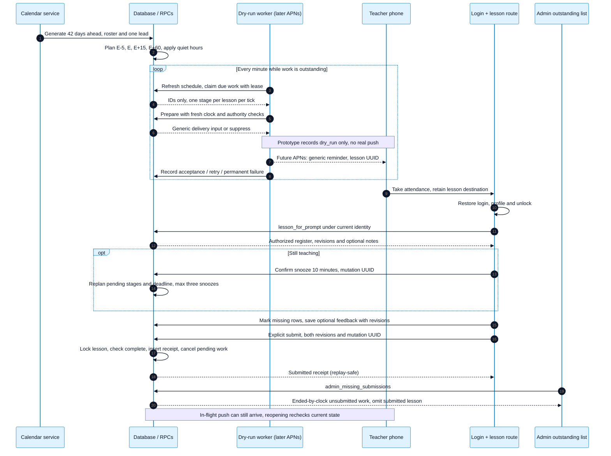
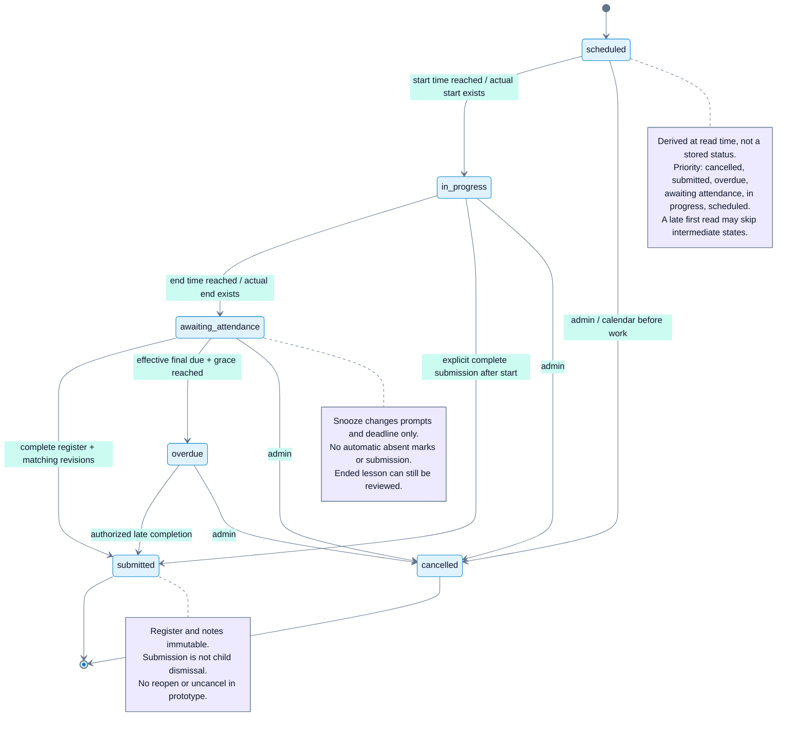
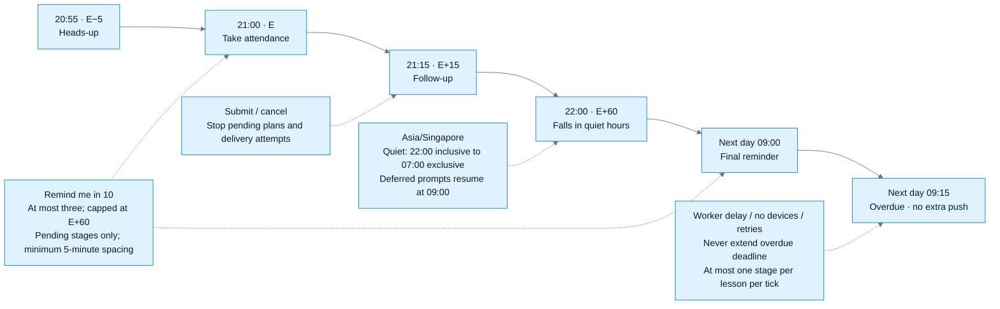
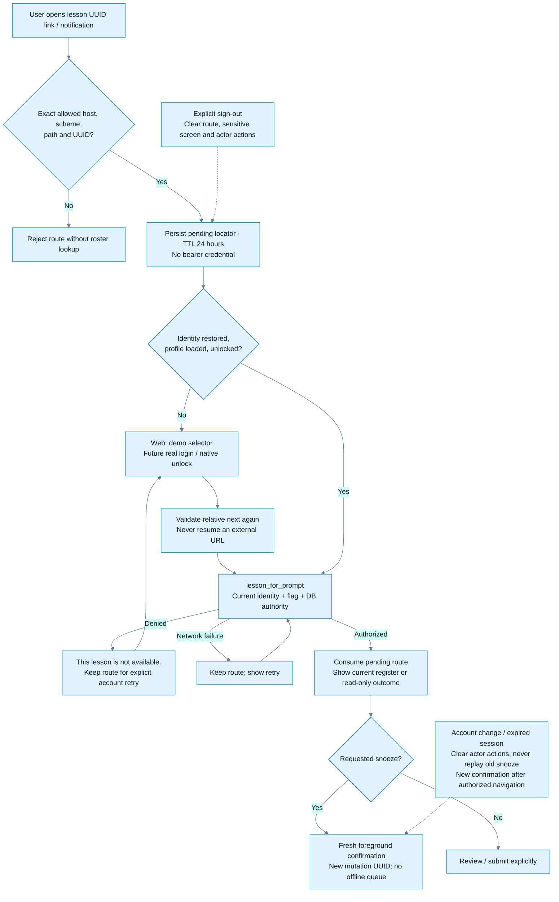
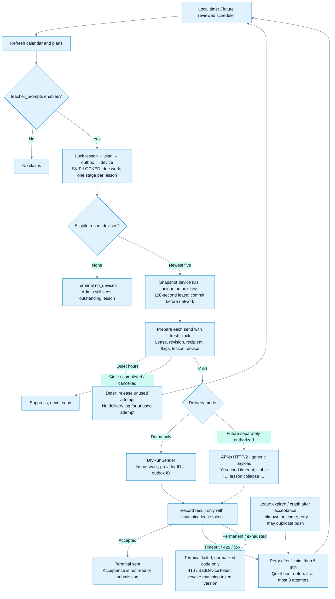

# Teacher prompts: review every lesson

## For Edmund

**Edmund's t466u brief — verbatim quotation pending.** The supplied pass prompt and
[contract](CONTRACT.md) refer to the brief but do not contain its original words.
Please supply the original text before this section is treated as an approved brief.
The following is a verbatim quotation of the contract's scope, not of Edmund:

> Build an interactive, local, fake-data prototype for a January 2027 fresh database:
> calendar-backed lessons → generic phone reminder → authenticated attendance review
> → optional feedback → explicit submission → admin view of outstanding work.
> Submission means the register was reviewed; it does not mean children went home.
> No parent notification, dismissal, payment, behavioural scoring, or email workflow.

A teacher should be able to open a reminder, reach the correct lesson even after
signing in, review each child's attendance, optionally add a short lesson note,
and press Submit. Staff should see which lessons still need that review. Teachers
who cannot receive push should find the same work in their lesson list.

The calendar creates lessons ahead of time. A lesson no longer disappears from
staff's view simply because nobody opened it in the app. One named lead teacher
or substitute is responsible for submitting it. Assistants can read their assigned
lesson but do not complete the accountable teacher's review.

Try the local demo by choosing Demo Teacher D, opening today's Mathematics lesson,
and selecting the simulated reminder. Review the register, mark the remaining
entries, optionally add notes, then submit. Switch to Demo Admin and check that
it no longer appears in missing submissions. Demo Teacher B should not be able to
open D's substituted lesson. The demo contains invented people only.

“Not Here Yet” means nobody has recorded a status. It never automatically becomes
absent. “Submitted” means the teacher reviewed a complete register. Neither a
notification, an elapsed deadline, nor submission says a child has left safely.

This is a **local prototype**, not a release. Push is dry-run only; the selector is
not real authentication. APNs, physical-device permissions, associated domains,
real-login routing and production operation have not been verified here. The iOS
work is an isolated routing sketch, not a change to the shipping app. Edmund's
final wording is pending in [strings.md](strings.md).

## Problem and scope

The prior [research](../../../tav-eod-link/research.md) examined the old clients and
schema. Its email-first recommendation is superseded by this pass's push brief.
The relevant observed seams are:

- Existing sessions are created by clients and unique per class/day. That cannot
  account reliably for every planned lesson or two separate lessons on one day.
- Native session lists can auto-end a session. That action is not teacher review;
  ordinary closed-session editing is also blocked in the old schema.
- Existing device registration serves parents. Teachers need a separately
  authorized registration path.
- Existing mobile login redirects to the class list and loses the lesson route.

V2 addresses these together in a separate, fresh-database schema chain under
`supabase/v2/`. It does not modify the historical migration chain. The contract is
normative; diagrams and this explanation are companions, not competing interfaces.

## Data model and authority

| Records | Purpose |
|---|---|
| `profiles`, `students`, `classes`, `enrollments` | Staff identity/role, minimal child records, classes and dated membership. `teacher` replaces the old `tutor` role in V2. |
| `terms`, `timetable_rules`, `calendar_exceptions` | Weekly calendar, term boundaries, centre/class holidays and closures. |
| `lessons`, `lesson_staff`, `lesson_roster` | Stable lesson UUID, scheduled instants, exactly one accountable teacher, assistants/substitutes and a roster snapshot. |
| `attendance_records`, `lesson_feedback`, `lesson_submissions` | Three-valued attendance, optional notes and explicit immutable confirmation of specific register/feedback revisions. |
| `mutation_receipts`, `audit_events` | Actor-bound replay protection and minimal operational evidence. |
| `prompt_policy`, `notification_plans` | Reminder timings and four logical stages per lesson. |
| `teacher_devices`, `notification_outbox`, `notification_deliveries` | Private device registrations, per-device attempts, leases and normalized outcomes. |
| `feature_flags`, `runtime_settings` | Shared rollout switches and separately guarded demo mode. |

Generated lessons are unique by `(timetable_rule_id, occurrence_date)`, not
class/day. A reschedule preserves the lesson UUID and original occurrence identity,
updates scheduled instants, refreshes the unworked roster using the new Singapore
date, and replans pending prompts. Two nonoverlapping lessons on one day are allowed.
Class overlaps are rejected under a database lock. A closure retains a cancelled
occurrence for explanation. Removing a closure does not silently resurrect it.

Roster membership is materialized from inclusive enrollment dates; names remain in
`students`. Before work begins, safe calendar regeneration can refresh the roster
and its revision. Once work exists, regeneration preserves it and records conflicts
for admin review. Overrides protect intentional reschedules and staff changes.

RLS and guarded RPCs enforce authority. JWT `sub` selects an active database profile;
client metadata cannot grant a role. All ordinary direct writes are denied. Teachers
can review only their accountable lessons; assistants have scoped read access.
Parents, anonymous users and inactive/missing profiles have no prototype access.
Admins receive shaped delivery status, never device tokens or raw queue tables.
Study Space is excluded at the source of every list, report and prompt.

All writes serialize on the lesson row. Attendance uses expected register revision
and observed server `marked_at`, including observed-empty rows. Mutation UUIDs are
bound to actor, operation and arguments. Mark-all-present touches only unmarked
rows, preserving explicit absent/late records. Feedback has its own revision and
may be blank. Submit checks both revisions and requires a complete register;
only admins may submit a zero-member roster. After submission, attendance, notes
and roster are immutable. A later correction needs a separately designed audited
reopen workflow. Teachers may finish work through seven Singapore dates after its
start; older work stays with admins.

## Scheduling and reminder timeline

All instants are `timestamptz`; civil dates and times explicitly use
`Asia/Singapore` (UTC+8). Generate lessons 42 days ahead and refresh regularly.
The generator does not depend on client start/end controls. Optional actual
`started_at` and `ended_at` are evidence, not the source of reminder timing.

For scheduled finish **E**:

| Stage | Default | Example: lesson ends 21:00 SGT |
|---|---|---|
| Heads-up | E − 5 minutes | 20:55 |
| Attendance | E | 21:00 |
| Follow-up | E + 15 minutes | 21:15 |
| Final | E + 60 minutes, deferred through quiet hours | Next day 09:00 |
| Overdue | Effective final due + 15 minutes; no extra push | Next day 09:15 |

Quiet hours are `[22:00,07:00)`; deferred prompts resume at 09:00. Exactly 07:00 is
allowed; exactly 22:00 is quiet. Defer each stage through quiet hours, then space
successive stages at least five minutes apart. A 20:00 finish has its final at
21:00 that day. A delayed worker sends at most one stage per lesson per tick and
paces later stages; delay, delivery failure and lack of devices never extend the
overdue deadline.

“Remind me in 10” postpones pending reminders, at most three accepted requests.
It is available from E−5, extends from the later of now/current snooze, and is
capped at E+60 before quiet-hour deferral. It updates the effective overdue deadline;
it does not change scheduled finish, mark students, or submit. An exact retry of
the same mutation UUID does not spend another snooze.

States are derived in priority order: cancelled, submitted, overdue, awaiting
attendance, in progress, scheduled. Reading a lesson late may skip intermediate
states. An admin may cancel before submission, retaining all work and stopping
pending reminders. There is no uncancel operation in this prototype.

## Push delivery, devices and offline behavior

A durable plan exists independently of phones. When due, the worker materializes
rows for the recipient's newest five active devices seen in 90 days. With no device,
it records one terminal `no_devices` outcome for the stage; the next stage can use
a newly registered device. The teacher's list and backlog remain available.

Claims use a 120-second lease and `SKIP LOCKED`; the transaction commits before any
network request. Immediately before sending, preparation rechecks current lease,
revision, lead teacher, flags, device ownership, lesson completion and quiet hours.
Submission, cancellation and substitution invalidate pending work atomically. A
request already in flight may still arrive after that change; opening it rechecks
current authority and state.

Transient failures retry after one minute, then five minutes, with at most three
attempts and quiet-hour deferral. Permanent failures terminate. An invalid APNs
token revokes only that registration version, so a delayed response cannot revoke
a newer token. An expired lease is an unknown outcome, not proof of non-delivery.
Timeout after acceptance may cause a duplicate. Provider acceptance is neither a
read receipt nor evidence of submission.

The future APNs adapter uses HTTP/2, ES256 token authentication, environment-specific
Apple hosts, a ten-second timeout, stable outbox UUID request IDs and one collapse
ID per lesson. Payload contains generic text, category, kind and lesson UUID only:
no names, class labels, counts, status, notes, tokens or authentication URLs. It
expires by the next stage or one hour, whichever comes first. The app recomputes
its badge from outstanding lessons rather than accepting a stale push badge.

Registration follows authenticated active teacher/admin identity, opt-in and flags.
Use the new `register_device`, never the old parent-only RPC. Sign-out tries to
revoke the device before ending auth and always clears local sensitive state and
actor-bound actions. Phone permission denial or offline delivery cannot block
manual access to the list. APNs is best effort and expired alerts may never appear.

The prototype does not implement offline web submission or background snooze.
An offline failure remains visibly incomplete until a successful server response.
Future native attendance queues must remain actor-bound, clear on sign-out, retain
mutation UUIDs and compare observed server timestamps; they must never overwrite
newer work or replay another account's mutations. Snooze always needs a fresh,
authenticated foreground confirmation.

Locally, `DryRunSender` records outcomes without a network push. SQL optionally
installs a planning-only cron job if `pg_cron` exists; local Postgres needs no such
extension. The local worker refreshes the schedule and ticks every minute. A future
hosted worker wakeup and invocation secret require a separate reviewed installation.
Both shared flags default OFF; fake seed turns only `teacher_prompts` ON. Real
push remains disabled throughout this work.

## Deep links and preserving the destination through login

The route forms are `https://<approved-host>/t/lesson/<lowercase-uuid>` and
`tava://teacher/lesson/<lowercase-uuid>`. They locate work; possession grants no
access. Reject extra segments, encoded separators, queries, fragments, userinfo,
external `next` values and protocol-relative destinations.

Web stores a validated relative lesson path in an HttpOnly pending-route cookie
for 24 hours and sends unsigned users to `/demo?next=...`. It validates again at
resume and resolves `lesson_for_prompt` under the chosen identity before consuming
the route. Wrong identity shows a neutral unavailable state with an explicit
account retry; a network failure keeps the route. It never jumps to a default
list before trying the requested lesson. The demo identity cookie is allowlisted,
HttpOnly and SameSite=Lax. Hosted use needs Secure cookies and a protected entry
boundary; the local selector deliberately allows selection of Demo Admin.

The iOS sketch waits for auth restoration, profile load and biometric unlock,
retaining a pending locator across process restart. Both notification actions
require foreground authentication. `TAKE_ATTENDANCE` opens the lesson;
`SNOOZE_10` opens it and asks for fresh confirmation. Sign-out clears route and
actions. During a login/account transition, navigation intent may survive, but an
action from the prior account must never execute under the new account.

## Privacy and staff follow-up

Child names are only shown on the authorized register. They never belong in push
payloads, logs or URLs. No analytics or third-party scripts are needed. Lesson
feedback is optional, at most 1,000 characters, with guidance to omit personal
details and an NRIC/FIN-like pattern guard. Pattern detection cannot guarantee
that free text is safe. Feedback is not parent-visible.

Audit records contain allowlisted event codes, counts and revisions, never copied
rosters, feedback, tokens or provider response bodies. Device material is service-only.
Staff notice, processor assessment, feedback purpose, access/correction/erasure and
retention are school/DPO decisions before real data. Thirty-day delivery-log and
revoked-token retention are proposals, not implemented jobs or legal claims.

Admin `/admin` uses `admin_missing_submissions` over a bounded Singapore date range.
It shows noncancelled, unsubmitted lessons whose scheduled end has passed, including
lessons with no attendance rows, not just those already overdue. Rows show lead,
progress, deadline and shaped delivery state. `accepted` in this demo means dry-run
acceptance; it does not mean the teacher received or read anything. Submitted rows
disappear. Staff can assign a substitute, cancel, or reschedule eligible unworked
future lessons through guarded RPCs. Removing the old lead immediately removes
review authority unless separately retained as a read-only assistant.

## Run and verify locally

Prerequisites: Bash, Python 3, Bun matching the prototype lockfiles, PostgreSQL 17
client tools (`psql`, `createdb`, `dropdb`, `pg_isready`), and PostgreSQL 17 server
binaries on PATH or at `/workspace/tav-teacher-prompts/pgbin/package/native/bin`.
The runner never installs global services, reads `.env` files or uses inherited
DB/APNs credentials. It requires only local Postgres plus pgcrypto; no pgTAP/cron.
Use only your supervisor-assigned database; Pass E uses `tp_e`.

```bash
scripts/teacher-prompts-local.sh --db tp_e --reset
```

First run creates the named throwaway database; `--reset` explicitly drops/recreates
only that database. Without reset, reuse requires a matching schema fingerprint and
demo marker. Shim, sorted V2 migrations and fake seed run only on new/reset DBs.
The default shifts demo dates so Mathematics is today; `--fixed-week` leaves dates
unchanged (use it with reset to restore January 1–7, 2027). It is not a frozen clock:
UI mutations still use server time. Before today's demo start, marking is unavailable.
Use simulation to inspect the notification independently, or the E2E fixture for a
complete flow at any time of day.

The runner installs both frozen lockfiles, starts the dry-run worker and web on
`127.0.0.1:3100`, prints `/demo`, `/` and `/admin`, and stops child processes on exit.
It keeps Postgres running because other passes may share the local server. It does
not stop another process occupying port 3100; that is a startup error.

```bash
scripts/teacher-prompts-local.sh --db tp_e --reset --fixed-week --check
```

`--check` runs SQL regressions (schema OFF defaults before seed), the concurrency
suite and each package's unit-test script without starting web. On an existing DB
it requires explicit `--reset`; check mode leaves the fixtures in their canonical
week so calendar assertions remain repeatable. For browser checks, stop the runner, reset as above,
then let the prototype's Playwright configuration manage its local server:

```bash
cd prototypes/teacher-prompts
TEACHER_PROMPTS_DATABASE_URL=postgresql://postgres@localhost:55432/tp_e \
TEACHER_PROMPTS_DB_NAME=tp_e TEACHER_PROMPTS_DEMO=1 \
  bun --no-env-file run test:e2e
```

Do not run the same assigned database concurrently with destructive fixture tests.
E2E uses fake fixtures, mobile Chromium and desktop admin, and blocks external
requests. The supervisor combines owner-specific test evidence; a build is not
proof of a teacher completing a flow.

## Local verification snapshot (Pass E)

These results describe the local working files during parallel implementation, not
a release or production state. Commands used only the assigned `tp_e` database.

| Check | Result |
|---|---|
| `bash -n scripts/teacher-prompts-local.sh` | Passed. |
| Runner argument validation | 12 passed, 0 failed; malformed/remote/reserved DB arguments rejected before connection. |
| Six `npx mmdc -p puppeteer.json -b white -s 2` renders | 6 passed, 0 failed on final render; all PNGs opened and each exceeds 10 KB. README embeds exactly match the sources. |
| `--db tp_e --reset --fixed-week --check` SQL suites | 219 assertions passed, 0 failed across 8 files; schema OFF-default tests run before seed. |
| Same runner's concurrency step | Blocked with `Only tp_a or tp_a_scratch is permitted`; 0 concurrency cases ran on `tp_e`. Pass A must allow the explicit assigned DB argument before this integration command can pass. |
| Worker package `bun --no-env-file run test`, run separately | 76 passed, 0 failed, 13 skipped (owner-specific DB integration suite). |
| Web package `bun --no-env-file run test`, run separately | 36 passed, 0 failed. These unit tests do not prove a browser flow. |
| Local worker `--once --now 2027-01-07T13:05:00Z` on canonical fixtures | 1 claimed, 1 dry-run accepted, 0 failed, 0 suppressed; no APNs request. |
| Default runner date shift | Passed; Mathematics moved to the server's Singapore date. |
| Full runner web startup | Initially failed `TP_DATABASE_NOT_ASSIGNED` (web hard-coded `tp_c`); Pass C subsequently accepts the supplied DB name. Latest startup stopped because port 3100 was occupied by another process; that process was left untouched. Browser/manual QA remains unrun by Pass E. |
| Cold PostgreSQL startup | Unrun; existing local PostgreSQL 17 server used. No shared server restart attempted. |

The installed Bun used for these checks was 1.4.4; contract/package-manager target
is 1.3.14. Lockfiles were installed with `--frozen-lockfile`. Repeat the final
integration check with the agreed runtime after the owners finish their files.
Real login, APNs, native permissions, associated domains, hosted preview and all
cutover gates remain unrun. The exact t466u quotation is still awaiting its source.

## Fresh database cutover

The intended target is a fresh database for the new year, not applying V2 alongside
the old schema. [cutover.md](cutover.md) gives ordered gates and rollback. Existing
parent, kiosk, station, dismissal and PDPA capabilities still need an explicit
parity decision and implementation before this can replace the current product.
Never install the local Auth shim or demo seed into the future live backend.
Old writes are frozen only at an approved switchover. Retain the old environment
and an approved encrypted archive through the recovery window; deleting the old
database ends that rollback path. No cutover is authorized or performed here.

For a phone review link, see [preview-deploy.md](preview-deploy.md). Publishing the
selectable-admin prototype unchanged is blocked; that guide
identifies the protected preview adapter work and a local, fake-data alternative.

## Open decisions for Edmund and TAVA

1. Supply the original t466u brief and approve the stand-in copy.
2. Confirm one accountable lead/substitute and read-only assistants.
3. Try four prompts, three snoozes and the quiet-hours defaults; decide whether
   fewer reminders would help teachers more.
4. Name the person who follows up overdue work and maintains timetable, closures
   and substitutes; confirm the seven-day teacher editing window.
5. Confirm the purpose, readers and follow-up for optional lesson notes.
6. Choose an approved universal-link host and supported teacher devices/platforms.
7. Decide mandatory launch parity for parent/kiosk/station/privacy workflows.
8. Approve retention/archive, staff notice, processor review and real-device pilot
   acceptance before enabling any real deployment or destructive cutover.

## Diagrams

Each Mermaid block below matches the adjacent `.mmd` source. Rendered PNG review
artifacts are written to `/workspace/tav-teacher-prompts/diagrams/`; those files are
outside this repository's documentation tree. Regenerate with the installed tool:

```bash
cd /workspace/tav-teacher-prompts/tools
npx mmdc -p puppeteer.json -b white -s 2 \
  -i /workspace/tav-tp/docs/teacher-prompts/diagrams/er.mmd \
  -o /workspace/tav-teacher-prompts/diagrams/er.png
```

Repeat for each source below. These describe the contract, not measured deployment.

### Data relationships

Selected columns are shown; `auth_users` denotes hosted/local `auth.users`.
The diagram shows domain relationships rather than every audit-actor foreign key.

[Mermaid source](diagrams/er.mmd)



### One lesson from planning to submission

[Mermaid source](diagrams/lesson-lifecycle-sequence.mmd)



### Derived lesson states

[Mermaid source](diagrams/lesson-state.mmd)



### 21:00 finish and quiet hours

[Mermaid source](diagrams/prompt-timeline.mmd)



### Preserving the lesson route

[Mermaid source](diagrams/auth-route.mmd)



### Delivery, retries and suppression

[Mermaid source](diagrams/dispatch.mmd)


